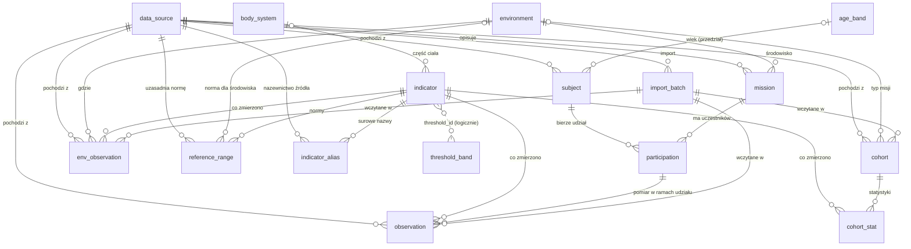

# Baza danych zdrowia astronautów: plan relacji i zawartości

Wersja schematu: **0.2** (2026-11-14) · Silnik: **MariaDB 11.4 LTS** · Kodowanie: `utf8mb4` · Status: **projekt**. Schemat SQL jest w [`schema/`](schema/), a danych jeszcze nie importowano.

## TL;DR

1. **Dwie bazy:** `astro_core` (tabele; zapisuje do niej tylko import) i `astro_api` (widoki; z niej **czytają wszyscy**). GUI, silnik reguł i eksport nigdy nie sięgają do tabel bezpośrednio.
2. **Podział danych na trzech osiach:** **źródło** (`data_source`), **osoba** (`subject` + `participation` + `mission`) i **wskaźnik** (`indicator`). Każda obserwacja wskazuje wszystkie trzy, więc każdy przekrój to jeden `SELECT` z widoku.
3. **Dane referencyjne** (`reference_range`) mają normy zależne od **płci, wieku, populacji i środowiska**. Widok sam dobiera najlepiej pasującą normę do każdego pomiaru i oznacza konflikt z normą zapisaną w pliku źródłowym.
4. **Model „jeden pomiar = jeden wiersz”** (`observation`). Nowy wskaźnik to nowy wiersz w słowniku, a nie nowa kolumna.
5. Dla aplikacji offline działa **eksport do JSON** z podziałem na źródła i osoby (`exports/sources/…`, `exports/subjects/…`).

---

## 1. Zasady projektowe

| # | Zasada | Dlaczego |
|---|---|---|
| 1 | **Odczyt tylko przez `astro_api`** (widoki, użytkownik `astro_reader`) | Stabilny kontrakt: tabele mogą się zmieniać, a nazwy i kolumny widoków zostają. |
| 2 | **Każdy pomiar ma pochodzenie:** `source_id`, `import_batch_id`, surowa nazwa, wartość i jednostka | Da się odtworzyć, skąd pochodzi każda liczba na ekranie. |
| 3 | **Czas względem misji:** `anchor` (`launch`/`landing`) + `day_offset`, a faza (`pre`/`in`/`post`) jest wyliczana automatycznie | Notacja NASA (L-92, FD30, R+45) i bed rest (PRE/IN/POST) w jednym modelu. |
| 4 | **Jednostki kanoniczne:** jedna jednostka na wskaźnik, przeliczenia w `indicator_alias` | Porównywalność danych z różnych źródeł. |
| 5 | **Normy zależą od płci i wieku** (`reference_range`), a norma z pliku jest tylko rezerwą | W danych Inspiration4 normy z pliku bywają błędne (patrz §5.4). |
| 6 | **Import idempotentny:** unikalny `natural_key` + `INSERT … ON DUPLICATE KEY UPDATE` | Ponowny import nie tworzy duplikatów. |
| 7 | **Prywatność:** pseudonimowe kody osób, wiek tylko jako przedział, bez dokładnych dat i nazwisk | Dane medyczne. Nie wolno umożliwić identyfikacji osób. |
| 8 | **Uczciwe etykiety:** `data_kind` (`real_spaceflight` / `real_analog` / `synthetic` …) dostępny w każdym widoku | UI musi odróżniać lot kosmiczny, bed rest i symulację. |

---

## 2. Architektura

```
data/nasa/*.csv, data/lsda/** (surowe, read-only)
        │  adaptery (po jednym na format źródła)
        ▼
data/processed/*.canonical.csv  ── load.py ──►  astro_core  (tabele)
                                                    │  widoki
                                                    ▼
                                                astro_api ──► GUI / MEDICAL-DIAGNOSIS / export.py ──► exports/*.json
```

| Baza | Zawartość | Kto pisze | Kto czyta |
|---|---|---|---|
| `astro_core` | 16 tabel: słowniki, dane referencyjne, osoby, pomiary | `astro_etl` (import) | `astro_etl` |
| `astro_api` | 19 widoków (§8) | definiowane w `schema/002_api_views.sql` | `astro_reader` (wszystkie moduły), `astro_etl` |

Użytkownicy (`schema/003_users.sh`, hasła z `DATABASE/.env`): `astro_etl` ma `SELECT/INSERT/UPDATE/DELETE` na `astro_core.*`. `astro_reader` ma **wyłącznie `SELECT` na `astro_api.*`**. Hasła trzymamy w `DATABASE/.env`, poza gitem.

---

## 3. Model relacji



**Kluczowe relacje:**
- **Osoba ↔ misja to relacja N:M przez `participation`.** Jedna osoba może brać udział w kilku misjach albo kampaniach. `observation` ma złożony klucz obcy `(subject_id, mission_id)` → `participation`, więc pomiar zawsze należy do konkretnego udziału w misji. Dzięki temu „dzień misji” i baseline liczą się względem właściwej misji.
- **Obserwacja → źródło, osoba, wskaźnik.** To są trzy osie podziału danych. Każda kombinacja jest dostępna jako widok (§7).
- **`threshold_band` → `indicator`** to relacja logiczna (`indicator.threshold_id` / `baseline_threshold_id`), bez klucza obcego. `threshold_band` jest kopią `config/thresholds.json` i jest w całości nadpisywana przy imporcie.
- **`cohort` / `cohort_stat`:** dane zbiorcze z publikacji (średnia ± SD dla grupy). Celowo **nie** trafiają do `observation`, bo nie dotyczą konkretnej osoby.
- **`env_observation`:** pomiary środowiska (dawka, CO2, protony). Też nie dotyczą osoby.

---

## 4. Tabele (`astro_core`)

Dokładne typy i ograniczenia są w [`schema/001_core.sql`](schema/001_core.sql). Poniżej: po co jest każda tabela, kto ją wypełnia i co w niej będzie na start.

### 4.1. Słowniki i dane referencyjne

| Tabela | Cel | Klucz | Wypełnia | Zawartość startowa |
|---|---|---|---|---|
| `data_source` | Katalog źródeł: zbiory danych **i** literatura, z której pochodzą normy | `id` (slug) | ręcznie: `seed/sources.csv` | ~15 wierszy (§6) |
| `environment` | Środowiska misji: grawitacja, dawka/dzień, opóźnienie łączności | `code` | z `config/thresholds.json` + 2 dodatkowe | `earth`, `iss`, `cislunar`, `lunar_surface`, `mars_transit`, `mars_surface`, `leo_free_flyer` (Inspiration4), `analog_hdt` (bed rest) |
| `body_system` | Układy ciała → region klikalnej sylwetki | `code` | ręcznie | 11 wierszy, np. `cardiovascular→heart`, `musculoskeletal→bones`, `behavioral→head` |
| `age_band` | Przedziały wieku używane w całej bazie | `code` | ręcznie | `18-29`, `30-39`, `40-49`, `50-59`, `60-69`, `70+` |
| `indicator` | Słownik wskaźników: kod, nazwa, kategoria, układ ciała, jednostka kanoniczna, powiązanie z progami | `id`, unikalny `code` | `seed/indicators.csv` | ~150 wierszy: 23 z `config/thresholds.json`, 23 CBC, 19 CMP, 9 kardio, 71 cytokin, ~20 DXA i składu ciała, 3 BP z Mendeley |
| `indicator_alias` | Mapowanie surowej nazwy i jednostki ze źródła na wskaźnik, z przelicznikiem | `(source_id, raw_name, raw_unit)` | `seed/indicator_aliases.csv` | ~200 wierszy; np. `HEMOGLOBIN (FEMALE)` → `hemoglobin`; CRP pg/mL → mg/L (`factor = 1e-6`) |
| `reference_range` | **Normy zależne od płci, wieku, populacji i środowiska** oraz klasyfikacje (np. T-score) | `id`, unikalny `natural_key` | `seed/reference_ranges.csv` | patrz §5 |
| `threshold_band` | Progi ok/caution/alert z komunikatem, akcją i eskalacją | `id` | import z `config/thresholds.json` | ~90 przedziałów dla 23 wskaźników |

**Kategorie wskaźników** (`indicator.category`): `vitals`, `lab_cbc`, `lab_cmp`, `lab_cardio`, `lab_cytokine`, `bone_dxa`, `body_composition`, `fitness`, `sleep`, `mood`, `nutrition`, `environment`, `radiation`.

**Konwencja kodów wskaźników:** `snake_case`, po angielsku. Kod jest identyczny z `id` w `config/thresholds.json`, jeśli wskaźnik tam występuje, np. `heart_rate_resting` albo `bp_systolic`. Analizy laboratoryjne mają kod bez prefiksu panelu (`glucose`, `hemoglobin`, `crp`). DXA ma format `bmd_<region>`, `tscore_<region>`, `zscore_<region>`.

### 4.2. Misje, osoby, udział

| Tabela | Cel | Klucz | Uwagi |
|---|---|---|---|
| `mission` | Misja albo kampania badania (lot, bed rest, misja syntetyczna) | `id`, unikalny `code` | `start_date`/`end_date` tylko gdy publicznie znane (Inspiration4 tak, bed rest nie). `duration_days` pozwala liczyć dzień misji od startu. |
| `subject` | Osoba (pseudonim) | `id`, unikalny `code`, unikalne `(source_id, source_subject_code)` | `sex` (`F`/`M`/`U`), `age_band_code` (NULL = nieznany). **Bez nazwisk, dat urodzenia, wzrostu, wagi, pochodzenia etnicznego.** |
| `participation` | Udział osoby w misji | `(subject_id, mission_id)` | `role` (`crew`, `bed_rest_subject`, `control`, `synthetic_crew`), `group_label` (np. grupa z countermeasure) |

**Kod osoby:** `<ŹRÓDŁO>-<GRUPA>-<KOD_Z_PLIKU>`, np. `I4-C001`, `MR035G-C3A-224`, `MR035G-MEDES-A1`, `SYN-01`. Kody w plikach powtarzają się między kampaniami, dlatego potrzebny jest prefiks.

### 4.3. Dane

| Tabela | Ziarno (jeden wiersz to…) | Unikalność | Najważniejsze kolumny |
|---|---|---|---|
| `observation` | jeden pomiar jednego wskaźnika u jednej osoby w jednym punkcie czasowym (i jednym powtórzeniu) | `natural_key` = SHA-256 z (osoba, misja, wskaźnik, źródło, anchor, day_offset, measured_at, typ próbki, powtórzenie) | `anchor`, `day_offset`, `phase` (wyliczana), `timepoint_label`, `measured_at`, `replicate`, `value_num`/`value_text`, `ref_min`/`ref_max` (z pliku), `sample_type`, `is_synthetic`, `raw_*` |
| `cohort` | jedna grupa badanych z publikacji | `(source_id, source_row)` | `study_title`, `mission_type`, `n`, `n_male`, `n_female`, `age_mean`, `bmi_mean`, `countermeasure` |
| `cohort_stat` | średnia ± SD jednego wskaźnika w jednej fazie dla grupy | `(cohort_id, indicator_id, phase)` | `mean_value`, `sd_value` |
| `env_observation` | jeden pomiar środowiska (miejsce, czas) | `(environment, location, indicator, source, measured_at, aggregation)` | `aggregation` (`raw`, `hourly_mean`, `daily_mean`, `daily_sum`) |
| `import_batch` | jeden import jednego pliku | `id` | `file_sha256`, `adapter`, `rows_read/upserted/rejected`, `status` |

**Faza** jest kolumną generowaną: `launch` + ujemny dzień → `pre`; `landing` + dzień ≥ 0 → `post`; pozostałe z anchorem → `in`; bez anchora → `none`.

**`time_order`** (kolumna generowana) to klucz chronologii działający także wtedy, gdy długość misji jest nieznana (bed rest): `launch` → `day_offset`, `landing` → 100000 + `day_offset`, bez anchora → 200000 + numer dnia `measured_at`. Wszystkie widoki sortują po nim.

**Dlaczego `natural_key`, a nie zwykły klucz unikalny:** w MariaDB wartości `NULL` w kluczu unikalnym nie kolidują ze sobą, więc dwa identyczne wiersze z `measured_at = NULL` przeszłyby jako różne. Hash z `IFNULL(…, '')` usuwa ten problem.

---

## 5. Dane referencyjne: normy według płci, wieku i środowiska

### 5.1. Tabela `reference_range`: kolumny

| Kolumna | Znaczenie | Przykład |
|---|---|---|
| `indicator_id` | którego wskaźnika dotyczy | `hemoglobin` |
| `range_kind` | `reference_interval` (zakres normy) albo `classification` (klasa, np. osteopenia) | `reference_interval` |
| `class_label` | nazwa klasy (tylko dla `classification`) | `osteopenia` |
| `sex` | `F`, `M` albo `any` | `F` |
| `age_min`, `age_max` | przedział wieku w latach, oba końce włącznie | `18`, `120` |
| `population` | grupa, dla której norma obowiązuje | `general_adult`, `postmenopausal`, `astronaut` |
| `environment_code` | środowisko (NULL = dowolne) | NULL albo `iss` |
| `low_value`, `high_value` | granice; NULL = brak granicy | `11.7`, `15.5` |
| `low_inclusive`, `high_inclusive` | czy granica należy do przedziału (domyślnie tak) | `TRUE`, `TRUE` |
| `critical_low`, `critical_high` | wartości krytyczne, które oznaczają natychmiastową eskalację | NULL |
| `unit` | **musi** być równa `indicator.canonical_unit` (sprawdza import) | `g/dL` |
| `condition_note` | warunki pomiaru | `na czczo`, `w spoczynku, siedząc` |
| `source_id` | skąd pochodzi norma (zbiór danych albo literatura w `data_source`) | `osdr_osd569` |
| `basis` | `source` (z cytowanego źródła) albo `team_assumption` (nasza decyzja) | `source` |
| `priority` | rozstrzyga remis między równie pasującymi normami | `0` |

### 5.2. Jak wybierana jest norma dla pomiaru (widok `astro_api.reference_match`)

1. **Kandydaci:** ten sam wskaźnik, `range_kind = 'reference_interval'`, płeć osoby albo `any`, środowisko misji albo NULL.
2. **Wiek:** przedział wieku osoby (`age_band`) musi w całości mieścić się w `[age_min, age_max]`. **Gdy wiek jest nieznany**, pasują tylko normy obejmujące cały zakres 18–65 lat. Lepiej nie pokazać normy niż pokazać normę dla złej grupy wieku.
3. **Kolejność wyboru:** dokładna płeć przed `any` → norma dla środowiska przed ogólną → węższy przedział wieku → wyższy `priority`.
4. **Gdy w tabeli nie ma pasującej normy,** widok `observations` używa normy z pliku źródłowego (`file_ref_min`/`file_ref_max`). Kolumna `ref_basis` mówi, która norma została użyta (`reference_table` / `source_file`).
5. **`ref_conflict = 1`**, gdy norma z tabeli i norma z pliku są różne. Takie wiersze trzeba przejrzeć ręcznie.
6. **`ref_flag`:** `critical_low` / `below` / `in_range` / `above` / `critical_high`.

### 5.3. Zawartość startowa: normy laboratoryjne z plików Inspiration4 (OSD-569, OSD-575)

Wartości odczytane z kolumn `RANGE_MIN`/`RANGE_MAX` w plikach `data/nasa/*_long.csv`. Jednostki są takie jak w pliku.

**Morfologia (CBC), zakresy jednakowe dla K i M:**

| Wskaźnik | Norma | Jednostka |
|---|---|---|
| WBC | 3.8–10.8 | tys./µL |
| Płytki (PLT) | 140–400 | tys./µL |
| MCV | 80–100 | fL |
| MCH | 27–33 | pg |
| MCHC | 32–36 | g/dL |
| RDW | 11–15 | % |
| MPV | 7.5–12.5 | fL |
| Neutrofile | 38–80 % · 1500–7800 /µL |
| Limfocyty | 15–49 % · 850–3900 /µL |
| Monocyty | 0–13 % · 200–950 /µL |
| Eozynofile | 0–8 % · 15–500 /µL |
| Bazofile | 0–2 % · 0–200 /µL |

**Morfologia (CBC), zakresy zależne od płci:**

| Wskaźnik | Kobiety | Mężczyźni | Jednostka |
|---|---|---|---|
| Hemoglobina | 11.7–15.5 | 13.2–17.1 | g/dL |
| Hematokryt | 35–45 | 38.5–50 | % |
| Erytrocyty (RBC) | 3.8–5.1 | 4.2–5.8 | mln/µL |

**Panel metaboliczny (CMP), zakresy jednakowe dla K i M (dorośli):**

| Wskaźnik | Norma | Jednostka |
|---|---|---|
| Glukoza | 65–99 (status „na czczo” niepotwierdzony) | mg/dL |
| Sód | 135–146 | mmol/L |
| Potas | 3.5–5.3 | mmol/L |
| Chlorki | 98–110 | mmol/L |
| CO2 (wodorowęglany) | 20–32 | mmol/L |
| Mocznik (BUN) | 7–25 | mg/dL |
| BUN/kreatynina | 6–22 | — |
| Albumina | 3.6–5.1 | g/dL |
| Globuliny | 1.9–3.7 | g/dL |
| Białko całkowite | 6.1–8.1 | g/dL |
| Albumina/globuliny | 1.0–2.5 | — |
| Bilirubina całkowita | 0.2–1.2 | mg/dL |
| eGFR | ≥ 60 (`N/A` jako górna granica → NULL) | mL/min/1.73 m² |

**Panel metaboliczny (CMP), zakresy zależne od płci i wieku.** W plikach występuje kilka wariantów norm dla kobiet. Wariant zależy od osoby, czyli najpewniej od jej grupy wieku.

| Wskaźnik | Mężczyźni | Kobiety, wariant A | Kobiety, wariant B | Jednostka |
|---|---|---|---|---|
| ALT | 9–46 | 6–29 | 6–29 | U/L |
| AST | 10–40 | 10–30 | 10–35 | U/L |
| Fosfataza alkaliczna (ALP) | 36–130 | 31–125 | 37–153 | U/L |
| Kreatynina | 0.6–1.35 | 0.5–1.1 | 0.5–1.05 | mg/dL |
| Wapń | 8.6–10.3 | 8.6–10.2 | 8.6–10.4 | mg/dL |

> **Do uzupełnienia:** przedziały wieku dla wariantów A i B. Pliki ich nie podają, a wieku osób z Inspiration4 **nie** będziemy ustalać na podstawie publicznych informacji o załodze, bo to byłaby re-identyfikacja. Docelowe źródło norm z przedziałami wieku dla płci to katalog laboratorium referencyjnego (np. [Mayo Clinic Laboratories, Test Catalog](https://www.mayocliniclabs.com/test-catalog)). Do czasu uzupełnienia oba warianty zapisujemy z `age_min=18, age_max=120`, `priority` niższym niż norma męska i notatką „age-dependent, band unknown”.

### 5.4. Dlaczego norma z pliku nie wystarcza: wykryty błąd w danych

W `osd569`/`osd575` osoba **C003 (płeć F)** ma w trzech pomiarach przedlotowych (L-92, L-44, L-3) **męskie** normy: Hb 13.2–17.1, ALT 9–46, kreatynina 0.6–1.35, ALP 36–130. Od R+1 ma normy żeńskie. Gdybyśmy oceniali wyniki według normy z pliku, przedlotowe wyniki C003 byłyby oceniane według męskich norm. Tabela `reference_range` z dopasowaniem do płci naprawia to, a `ref_conflict = 1` oznacza te wiersze do przeglądu.

### 5.5. Zawartość startowa: klasyfikacje gęstości kości (DXA)

| Wskaźnik | Populacja | Płeć / wiek | Klasa | Zakres | Źródło |
|---|---|---|---|---|---|
| `tscore_*` | kobiety po menopauzie, mężczyźni ≥ 50 | F 50+, M 50+ | normal | T ≥ −1.0 | WHO 1994; ISCD |
| `tscore_*` | jw. | jw. | osteopenia (niska masa kostna) | −2.5 < T < −1.0 | WHO 1994; ISCD |
| `tscore_*` | jw. | jw. | osteoporosis | T ≤ −2.5 | WHO 1994; ISCD |
| `zscore_*` | kobiety przed menopauzą, mężczyźni < 50 | F 18–49, M 18–49 | below expected range for age | Z ≤ −2.0 | ISCD Official Positions |
| `zscore_*` | jw. | jw. | within expected range for age | Z > −2.0 | ISCD Official Positions |

Granice klas zapisujemy z flagami `low_inclusive`/`high_inclusive`, dzięki czemu klasy się nie nakładają: normal = [−1.0, ∞) (`low_inclusive=1`), osteopenia = (−2.5, −1.0) (obie flagi 0), osteoporosis = (−∞, −2.5] (`high_inclusive=1`). Widok `classifications` przypisuje pomiar do klasy i działa tylko dla osób ze znanym przedziałem wieku, bo klasyfikacja zależy od grupy wieku.

Dla bed restu i lotów **ważniejsza od T-score jest zmiana względem baseline'u osoby**. Progi `bmd_hip_spine_pct_baseline` (≥ 95%) i `bmd_femoral_neck_pct_baseline` (≥ 90%) z NASA-STD-3001 są w `threshold_band` i liczy je widok `change_from_baseline`.

### 5.6. Zawartość startowa: parametry życiowe

Parametry życiowe (BP, HR, temperatura, SpO2, sen, nastrój) **mają już progi** w `config/thresholds.json` (ze źródłami w `config/sources.json`). Importujemy je do `threshold_band`, a nie do `reference_range`, bo to reguły ok/caution/alert z komunikatem i akcją, a nie zakresy normy populacyjnej. Normy populacyjne dla płci i wieku (np. tętno spoczynkowe albo VO2max według wieku i płci) dodamy do `reference_range`, kiedy znajdziemy źródło:

| Wskaźnik | Zależność | Proponowane źródło (do weryfikacji) |
|---|---|---|
| VO2max | płeć × wiek | normy ACSM (tabele percentylowe) |
| Siła mięśni (uchwyt dłoni) | płeć × wiek | publikowane normy populacyjne (do znalezienia) |
| Skład ciała (% tkanki tłuszczowej) | płeć × wiek | normy DXA (np. NHANES) |
| BMI | dorośli, bez podziału na płeć | WHO |

### 5.7. Inne dane referencyjne

| Tabela | Co zawiera | Źródło |
|---|---|---|
| `environment` | grawitacja (g), dawka mSv/dzień (z zakresem), opóźnienie łączności (s), ochrona magnetosfery | `config/thresholds.json` → `environments` |
| `threshold_band` | progi NASA-STD-3001 i kliniczne (ok/caution/alert, komunikat, akcja, eskalacja, `basis`) | `config/thresholds.json` → `indicators` |
| `age_band` | przedziały wieku | stałe |
| `body_system` | układ ciała → region sylwetki | stałe (projekt UI) |
| `indicator_alias` | przeliczniki jednostek (np. CRP: 1 mg/L = 10⁶ pg/mL) | ręcznie, per źródło |

Limity dawek dla narządów (`radiation_organ_limits_mGyEq`) zostają w `config/`. Używa ich silnik reguł, a nie widoki.

---

## 6. Podział danych według źródeł

### 6.1. Katalog źródeł (`data_source`)

| `source_id` | Co to jest | `data_kind` | Dostęp | Stan | Adapter |
|---|---|---|---|---|---|
| `osdr_osd569` | Inspiration4, krew pełna: morfologia (CBC) | `real_spaceflight` | `files_public` | ✅ w `data/nasa/` | `osdr_long` |
| `osdr_osd575` | Inspiration4, surowica: panel metaboliczny (CMP), panel kardio/zapalny, cytokiny | `real_spaceflight` | `files_public` | ✅ w `data/nasa/` | `osdr_long`, `osdr_wide` |
| `mendeley_bp` | 75 badań: ciśnienie przed lotem, w locie i po locie (średnia ± SD), Mendeley DOI 10.17632/pz6nt4cpxs.1 | `literature_aggregate` | `files_public` (⚠ licencja niesprawdzona) | ✅ w `data/nasa/` | `mendeley_bp` |
| `lsda_mr035g` | NASA LSDA MR035G: DXA w bed rest (kości i skład ciała), DOI 10.83263/7myc-5j86 | `real_analog` | `files_public` | ⬇ do pobrania przez API LSDA | `lsda_dxa` |
| `synthetic_v1` | Generator danych symulacyjnych (stały seed), §10 | `synthetic` | `generated` | 🛠 do napisania | `synthetic` |
| `cdaweb_msl_rad` | Curiosity RAD: dawka na Marsie | `real_environment` | `files_public` | ⬇ API CDAWeb | `env_cdaweb` |
| `osdr_radlab` | ISS RadLab: dawka w modułach ISS | `real_environment` | `files_public` | ⬇ API OSDR | `env_radlab` |
| `osdr_eda` | ISS: CO2, temperatura, wilgotność kabiny | `real_environment` | `files_public` | ⬇ OSDR EDA | `env_eda` |
| `noaa_swpc` | Protony GOES ≥ 10 MeV, skale burz | `real_environment` | `files_public` | ⬇ JSON na żywo | `env_noaa` |
| `who_1994_osteoporosis` | Definicja osteoporozy wg T-score | `reference_literature` | — | ręcznie | — |
| `iscd_official_positions` | Interpretacja Z-score | `reference_literature` | — | ręcznie | — |
| + bibliografia z `config/sources.json` | źródła progów (NASA-STD-3001 itd.) | `reference_literature` | — | import z JSON | — |

### 6.2. Co zawiera każde źródło

| Źródło | Osoby | Wskaźniki | Punkty czasowe | Szacunkowa liczba wierszy | Cel w bazie |
|---|---|---|---|---|---|
| `osdr_osd569` (CBC) | 4 (I4-C001…C004) | 23 analityty (20 nazw + 3 warianty `(FEMALE)` → 20 wskaźników) | L-92, L-44, L-3, R+1, R+45, R+82, R+194 | 552 | `observation` |
| `osdr_osd575` (CMP) | 4 | 19 | jw. | 530 | `observation` |
| `osdr_osd575` (kardio) | 4 | 9 (CRP, fibrynogen, haptoglobina, PF4, AGP, A2M, fetuina A, L-selektyna, SAP) | jw. | 252 | `observation` |
| `osdr_osd575` (cytokiny) | 4 | 71 | jw. | 1 988 | `observation` |
| `mendeley_bp` | — (grupy) | SBP, DBP, MAP × przed/w locie/po | 3 fazy | 75 grup, ≤ 675 statystyk | `cohort`, `cohort_stat` |
| `lsda_mr035g` | ~70 (§7.2) | ~20 (BMD, T, Z dla regionów + skład ciała) | przed, w trakcie, po bed rest, kontrola po 6 mies. i po roku | ~10–30 tys. (do potwierdzenia po imporcie) | `observation` |
| `synthetic_v1` | 4 w `demo` (SYN-01…04), do 50 w `stress` | ~16 (§10.4) | codziennie / co tydzień / co 30 dni przez 180 dni | `demo` ~10 tys. (§10.2) | `observation`, `env_observation` |
| `cdaweb_msl_rad` | — | dawka µGy/dzień | 2012 → dziś, średnie dzienne | ~4–5 tys. | `env_observation` |
| `osdr_radlab`, `osdr_eda` | — | dawka, CO2, temp., RH | serie historyczne, agregowane do dni | kilka tys. | `env_observation` |
| `noaa_swpc` | — | strumień protonów | ostatnie 6 h (na żywo) | ~70 na pobranie | `env_observation` |

Bazę w całości szacujemy na ok. 50 tys. wierszy. To bardzo mało, więc wydajność nie jest problemem.

---

## 7. Podział danych według osób

### 7.1. Katalog osób

| Grupa (misja w bazie) | Kody osób | Płeć | Wiek | Środowisko | Dane każdej osoby |
|---|---|---|---|---|---|
| `I4` Inspiration4 (3 dni, 2021-09-16 → 2021-09-18) | `I4-C001` | M | nieznany (NULL) | `leo_free_flyer` | CBC 20, CMP 19, kardio 9, cytokiny 71; 7 punktów czasowych; ~830 pomiarów |
| | `I4-C002` | F | nieznany | jw. | jw. |
| | `I4-C003` | F | nieznany | jw. | jw. ⚠ błędne normy przedlotowe (§5.4) |
| | `I4-C004` | M | nieznany | jw. | jw. |
| `MR035G-C1` bed rest, kampania 1 | `MR035G-C1-C1G0001` … `C1G0003` (3) | z pliku | nieznany | `analog_hdt` | DXA: kręgosłup, biodra, pięta, przedramię, całe ciało, skład ciała; daty bez fazy (wymagają przeliczenia) |
| `MR035G-C3A` … `MR035G-C3H` bed rest, kampania 3 | np. `MR035G-C3A-224`; w nazwach plików: C3A 4, C3C 2, C3D 7, C3E 1, C3F 6, C3G 7, C3H 1; C3B do policzenia | z pliku | nieznany | `analog_hdt` | DXA w triplikatach: PRE (dzień 7–10 przed), IN (dzień ~63–65), POST (dzień 2 po) + kontrola po 6 mies. i po roku |
| `MR035G-MEDES` bed rest (MEDES, Francja) | `MR035G-MEDES-A1` … (24 kody, 2 kampanie) | głównie F | nieznany | `analog_hdt` | DXA: PRE (dni 14 i 2), IN (dzień 31), POST (dzień 3) |
| `MR035G-AGP` sztuczna grawitacja, pilot | 15 kodów (screening + analiza) | z pliku | nieznany | `analog_hdt` | DXA |
| `SYN-ISS-180`, `SYN-LUNAR-30`, `SYN-MARS-TRANSIT-210` (misje symulacyjne) | `SYN-01` … `SYN-04` | 2F / 2M | 30-39, 40-49, 50-59, 40-49 | `iss`, `lunar_surface`, `mars_transit` | profile i scenariusze w §10.3–10.5 |

> Liczby osób MR035G pochodzą z nazw plików i próbki 8 plików. Ostateczne liczby poda widok `subjects` po imporcie.

### 7.2. Czego **nie** zapisujemy o osobach

`PATIENT_KEY`, `SCANID` (najwyżej jako hash do rozróżnienia triplikatów), `SERIAL_NUMBER`, `ETHNICITY`, `MENOPAUSE_YEAR`, `WEIGHT`, `HEIGHT`, dokładne daty skanów, `PHYSICIAN_COMMENT`, nazwiska. Wiek zapisujemy tylko jako przedział (`age_band`), i to wyłącznie wtedy, gdy podaje go plik źródłowy.

---

## 8. Dostęp do danych: `astro_api`

### 8.1. Katalog widoków

| Widok | Jeden wiersz = | Do czego |
|---|---|---|
| **Katalogi** | | |
| `sources` | źródło + liczby osób, misji, wskaźników, pomiarów | „co mamy w bazie”, strona „Data sources” w UI |
| `missions` | misja / kampania + liczba osób | wybór kontekstu |
| `subjects` | osoba w misji + płeć, przedział wieku, źródło, liczby pomiarów i kategorie | lista osób, przełącznik astronauty |
| `indicators` | wskaźnik + układ ciała, region sylwetki, jednostka, progi, w jakich źródłach występuje | słownik, legenda, opisy edukacyjne |
| **Mapy pokrycia** | | |
| `source_data_map` | źródło × wskaźnik: liczba osób, pomiarów, punkty czasowe, min/max | „co zawiera źródło X” |
| `subject_data_map` | osoba × wskaźnik: liczba wartości, punkty czasowe | „jakie dane ma osoba Y” |
| **Dane referencyjne** | | |
| `reference_ranges` | norma: płeć, wiek, populacja, środowisko, granice, źródło | tabela norm w UI, audyt |
| `reference_match` | pomiar → wybrana norma | używany przez `observations` |
| `classifications` | pomiar → klasa (np. T-score: osteopenia) | wyniki DXA, opisy w UI |
| **Dane** | | |
| `observations` | jeden pomiar, wszystko złączone; norma dobrana do płci i wieku, `ref_flag`, `ref_conflict`, `mission_day` | główne źródło dla wykresów i tabel |
| `observations_mean` | punkt czasowy (średnia z powtórzeń, SD, liczba powtórzeń) | wykresy trendów (DXA!) |
| `baseline` | osoba × wskaźnik: średnia przedlotowa | porównania z baseline'em |
| `change_from_baseline` | punkt czasowy: delta, % baseline'u, status z progów % | „utrata kości −3%”, VO2max, masa ciała |
| `latest` | osoba × wskaźnik: ostatni pomiar + `status` + komunikat + akcja + eskalacja | **dashboard (kafelki)** |
| `body_system_status` | osoba × układ ciała: najgorszy status, liczba alertów | **klikalna sylwetka** |
| `daily_series` | osoba × wskaźnik × dzień + średnia 7-dniowa | wykresy serii dziennych |
| `environment_daily` | środowisko × wskaźnik × dzień | panel promieniowania i kabiny |
| `cohort_stats` | badanie × wskaźnik z fazami przed/w locie/po obok siebie | kalibracja generatora, slajdy „co mówi literatura” |
| `import_log` | jeden import | diagnostyka |

### 8.2. Gotowe zapytania

```sql
-- Jakie mamy źródła i ile w nich danych?
SELECT source_id, data_kind, n_subjects, n_observations FROM astro_api.sources;

-- Jakie osoby pochodzą ze źródła X?
SELECT subject_code, sex, age_band, mission_code, n_observations
FROM astro_api.subjects WHERE source_id = 'osdr_osd575';

-- Jakie dane ma osoba I4-C002?
SELECT category, indicator_code, n_timepoints, timepoints
FROM astro_api.subject_data_map WHERE subject_code = 'I4-C002' ORDER BY category, indicator_code;

-- Glukoza wszystkich osób Inspiration4 w czasie (z normą)
SELECT subject_code, timepoint_label, mission_day, value, unit, ref_min, ref_max, ref_flag
FROM astro_api.observations WHERE indicator_code = 'glucose' ORDER BY subject_code, mission_day;

-- Wyniki poza normą (dopasowaną do płci i wieku)
SELECT subject_code, indicator_code, timepoint_label, value, ref_min, ref_max, ref_flag, ref_basis
FROM astro_api.observations WHERE ref_flag IN ('below','above','critical_low','critical_high');

-- Pomiary, w których norma z pliku nie zgadza się z normą z tabeli (do przeglądu)
SELECT subject_code, indicator_code, timepoint_label, file_ref_min, file_ref_max, ref_min, ref_max
FROM astro_api.observations WHERE ref_conflict = 1;

-- Dashboard: ostatnie wyniki z kolorami
SELECT indicator_label, value, unit, status, message, action, escalate
FROM astro_api.latest WHERE subject_code = 'SYN-01';

-- Sylwetka: status każdej części ciała
SELECT body_region, status, n_alert, n_caution FROM astro_api.body_system_status WHERE subject_code = 'SYN-01';

-- Utrata gęstości kości w bed rest (% baseline'u, średnia z triplikatów)
SELECT subject_code, timepoint_label, value, baseline_value, pct_of_baseline, baseline_status
FROM astro_api.change_from_baseline WHERE indicator_code = 'bmd_lumbar_spine';

-- Seria tętna z 7-dniową średnią kroczącą
SELECT measured_date, value, value_7d_mean FROM astro_api.daily_series
WHERE subject_code = 'SYN-01' AND indicator_code = 'heart_rate_resting';
```

### 8.3. Dostęp z Pythona

```python
import pymysql, pymysql.cursors

conn = pymysql.connect(host="127.0.0.1", user="astro_reader", password="…",
                       database="astro_api", cursorclass=pymysql.cursors.DictCursor)
with conn.cursor() as cur:
    cur.execute("SELECT * FROM latest WHERE subject_code = %s", ("SYN-01",))
    tiles = cur.fetchall()        # lista słowników: gotowe do json.dumps
```

### 8.4. Eksport JSON (dla GUI działającego offline)

`etl/export.py` zapisuje widoki do plików z podziałem **na źródła i na osoby**:

```
exports/
  manifest.json                 # data wygenerowania, wersja schematu, lista plików z liczbą rekordów
  catalog/
    sources.json  missions.json  subjects.json  indicators.json  reference_ranges.json
  sources/
    osdr_osd575.json            # source_data_map + observations danego źródła
    lsda_mr035g.json
    …
  subjects/
    I4-C001.json                # profil + subject_data_map + latest + body_system_status
    …                           #   + observations_mean + change_from_baseline + daily_series
  environment/
    iss.json  mars_surface.json # environment_daily
  literature/
    cohort_stats.json
```

Format: tablica obiektów, klucze w `snake_case` (jak kolumny widoków), daty w ISO 8601 (UTC), brak wartości = `null`, liczby jako liczby (nie stringi). Każdy plik osoby i źródła zawiera pola `data_kind` i `is_synthetic`, żeby UI mogło pokazać etykietę „simulated” albo „bed rest analog”.

---

## 9. Import (CSV → baza)

### 9.1. Kolejność ładowania

1. `age_band`, `body_system`, `environment` (seed + `config/thresholds.json`)
2. `data_source` (seed + `config/sources.json`)
3. `indicator`, `indicator_alias`, `reference_range` (seed CSV)
4. `threshold_band` (z `config/thresholds.json`, całość nadpisywana)
5. `mission`, `subject`, `participation` (adaptery albo seed)
6. `observation`, `cohort` + `cohort_stat`, `env_observation` (adaptery → format kanoniczny → `load.py`)

### 9.2. Format kanoniczny (wspólny dla wszystkich adapterów)

UTF-8 bez BOM, separator `,`, kropka dziesiętna, puste pole = NULL:

```
source_id,subject_code,mission_code,indicator_code,timepoint_label,anchor,day_offset,time_is_approx,measured_at,replicate,value,unit,ref_min,ref_max,sample_type,is_synthetic,raw_name,raw_value,raw_unit
```

### 9.3. Mapowanie punktów czasowych

| Zapis w źródle | `anchor` | `day_offset` | `phase` (wyliczana) |
|---|---|---|---|
| `L-92` (Inspiration4) | `launch` | −92 | `pre` |
| `FD30` | `launch` | 30 | `in` |
| `R-30` | `landing` | −30 | `in` |
| `R+1` | `landing` | 1 | `post` |
| bed rest `PRE_TEST`, `BR_DAY=7` | `launch` | −7 | `pre` |
| bed rest `IN_TEST`, `BR_DAY=64` | `launch` | 64 | `in` |
| bed rest `POST_TEST`, `BR_DAY=2` | `landing` | 2 | `post` |
| bed rest `NA` + plik `…_6MO_…` / `…_1Y_…` | `landing` | 182 / 365, `time_is_approx=1` | `post` |
| Campaign 1 (tylko data) | wymaga dat bed restu z dokumentacji kampanii | — | — |
| seria syntetyczna | `launch` | dzień misji | `in` |

### 9.4. Walidacja (wiersz odrzucony + powód w raporcie)

- `indicator_code` nie istnieje w `indicator`;
- `unit` ≠ `indicator.canonical_unit` (po przeliczeniu z `indicator_alias`);
- wartość nieliczbowa przy `value_type = numeric`;
- nie da się sparsować punktu czasowego;
- osoba bez `participation` w podanej misji;
- dla `reference_range`: `unit` ≠ jednostka kanoniczna, `low_value > high_value`, `age_min > age_max`.

### 9.4a. Zasady wykonania importu

- **Jeden plik = jedna transakcja.** Błąd w trakcie oznacza wycofanie całego pliku i `import_batch.status = 'failed'`, bez częściowych danych.
- **`--replace-source`:** po udanym imporcie usuwa wiersze tego źródła, których nie było w bieżącym imporcie (np. po poprawce pliku). Bez tej opcji import tylko dopisuje i aktualizuje.
- **Numer powtórzenia (`replicate`)** nadajemy po posortowaniu skanów według `SCANID`, więc jest identyczny przy każdym imporcie (wchodzi do `natural_key`).
- **Spójność jednostek:** jednostka każdego wskaźnika z progami w `config/thresholds.json` musi być równa `indicator.canonical_unit`. Import przerywa się, jeśli tak nie jest. To samo dotyczy `reference_range.unit`.
- **Czyszczenie norm z pliku:** jeśli norma w wierszu równa się normie przeciwnej płci (przypadek C003, §5.4), adapter zastępuje ją najczęstszą normą tej samej osoby i tej samej płci, a zmianę zapisuje w raporcie importu. Normy zależne od wieku (warianty A/B, §5.3) zostają z pliku, dopóki nie znamy przedziałów wieku.

### 9.5. Pułapki w obecnych plikach

| Plik | Pułapka | Obsługa |
|---|---|---|
| `osd569_*_cbc_long.csv` | mieszane końce linii (`R+1\r`); kolumna czasu `TEST_DATE` | `strip()`, mapowanie nazwy kolumny |
| `osd575_*_cmp_long.csv` | kolumna czasu `timepoint`; eGFR `RANGE_MAX = N/A` | mapowanie; `N/A` → NULL |
| `*_wide.csv` | BOM UTF-8; `Sample Name` = `C001_serum_L-3`; niespójne nazwy kolumn (`alt_max_units_per_liter`) | `utf-8-sig`; parsowanie nazwy próbki |
| kardio/cytokiny `*_percent` | znaczenie niezweryfikowane | **nie importujemy** |
| `mendeley_bp_in_spaceflight.csv` | `np.nan`, puste pola, tytuły z przecinkami i `_x0001_`, niespójne nazwy kolumn | `csv` + czyszczenie; `np.nan` → NULL |
| LSDA MR035G | brak jednostek; `0` = brak regionu; triplikaty bez numeru; korekta kalibracji 6/9/06–8/10/06 (BMD ×1.0120), nie wiadomo, czy już nałożona; różne formaty kodów osób; duplikaty plików per osoba i zbiorczych | jednostki „inferred”; 0 → NULL; `replicate` wg kolejności skanu; sprawdzić korektę na danych; prefiks kampanii; importować tylko pliki zbiorcze |

---

## 10. Dane symulacyjne do testów całej aplikacji

Publiczne dane nie zawierają codziennych parametrów życiowych astronautów. Dane symulacyjne pełnią więc dwie role: **paliwo dla demo** i **dane testowe dla całego łańcucha**: generator → import → baza → widoki → silnik reguł → backend → GUI.

### 10.1. Zasady

| Zasada | Szczegół |
|---|---|
| Ta sama ścieżka co dane prawdziwe | Generator zapisuje **format kanoniczny CSV** (§9.2), a dane trafiają do bazy przez `load.py`. Testujemy więc też import. |
| Deterministyczność | Stały `seed`. Ten sam seed i ta sama wersja generatora dają identyczne pliki (porównanie po SHA-256). |
| Wersjonowanie | Źródło `synthetic_v1`. Zmiana modelu generatora oznacza nowe źródło (`synthetic_v2`), więc stare wyniki testów da się odtworzyć. |
| Oznaczenia | `is_synthetic = 1`, `data_kind = 'synthetic'`, kody `SYN-…`, misje `SYN-…`. Danych symulacyjnych nigdy nie mieszamy z osobami prawdziwymi. |
| Kalibracja ze źródeł | Każdy parametr modelu ma `source` (id z `config/sources.json`) albo `basis: team_assumption`, tak jak progi w `config/`. |
| Oczekiwane wyniki | Generator razem z danymi zapisuje plik `expected.json`: co i kiedy ma wykryć baza i silnik reguł. Testy E2E porównują z nim wyniki. |
| Tryb „as-of” | `--until FD68` ucina dane na danym dniu misji. Widok `latest` pokazuje wtedy stan z tego dnia. Służy to do testów scenariuszy i do odtwarzania misji dzień po dniu w demo. |

### 10.2. Zestawy danych

| Zestaw | Do czego | Osoby × czas | Wielkość (szac.) |
|---|---|---|---|
| `fixture_min` | testy jednostkowe reguł i widoków | 1 osoba × 14 dni; **wartości graniczne każdego progu** (§10.6) | ~500 wierszy |
| `demo` | prezentacja i testy E2E scenariuszy | 4 osoby × 180 dni na ISS + baseline sprzed lotu + 30 dni po | ~10 tys. pomiarów osób + ~13 tys. pomiarów środowiska (co godzinę) |
| `environments` | przełącznik środowisk w UI | te same 4 osoby w misjach `SYN-LUNAR-30` (`lunar_surface`) i `SYN-MARS-TRANSIT-210` (`mars_transit`) | ~15 tys. |
| `edge_cases` | odporność importu | celowo błędne wiersze (§10.7) | ~50 wierszy |
| `stress` | wydajność widoków i backendu | 50 osób × 365 dni, wearable co godzinę | ~1,5 mln |

Zestaw `environments` korzysta z relacji N:M `participation`: te same osoby biorą udział w kilku misjach, a baseline i dzień misji liczą się osobno dla każdej z nich.

### 10.3. Profile osób (`demo`)

| Kod | Płeć | Przedział wieku | Charakter w scenariuszu |
|---|---|---|---|
| `SYN-01` | F | 30-39 | podatna na deficyt snu (S2, S9) |
| `SYN-02` | M | 40-49 | ryzyko sercowo-naczyniowe (S1, S8, S12) |
| `SYN-03` | M | 50-59 | „osoba kontrolna”: przez większość misji w normie; infekcja (S4), utrata masy (S7) |
| `SYN-04` | F | 40-49 | zdrowie behawioralne (S3), przerwa w danych (S10) |

Baseline każdej osoby (tętno spoczynkowe, BP, temperatura, masa ciała, VO2max, BMD, wyniki krwi) jest losowany z realistycznych zakresów. Wyniki krwi kalibrujemy na wartościach przedlotowych Inspiration4. Baseline'owe punkty czasowe to L-180, L-90 i L-45.

### 10.4. Model wskaźników

| Wskaźnik | Częstotliwość | Baseline (szum) | Zmiana w locie | Źródło kalibracji |
|---|---|---|---|---|
| `heart_rate_resting` | codziennie rano | 55–70 bpm (SD 3) | brak zmiany | `norsk_2015` |
| `bp_systolic` / `bp_diastolic` | codziennie | 110–125 / 70–80 (SD 5/4) | −8…10 mmHg, narasta przez ~14 dni; wartości przed lotem, w locie i po locie porównywane z `cohort_stats` (Mendeley) | `norsk_2015`, `mendeley_bp` |
| `body_temperature` | codziennie | 36.4–36.8 °C (SD 0.15) | domyślnie brak; opcjonalnie +~1 °C w ciągu ~2,5 mies. (parametr) | `stahn_2017` |
| `spo2` | codziennie | 96–99 % | brak | `medlineplus_spo2` |
| `glucose_fasting` | co tydzień | 80–95 mg/dL (SD 5) | brak | `ada_diagnosis` (zakresy) |
| `sleep_hours` | codziennie | 7.5–8 h | średnio **~6 h** w locie (SD 0.8) | `ochmo_tb_sleep`, `hrr_er_sleep` |
| `mood` (1–5) | codziennie | 4 (szum ±1) | brak trendu | `team_assumption` |
| `exercise_minutes_daily` | codziennie | — | 90–120 min przez 6 dni w tygodniu, 7. dzień 0 | `scott_2023`, `petersen_2016` |
| `energy_intake_pct_target` | codziennie | — | 85–100 % celu 3035 kcal | `nasa_std_3001_v2` |
| `body_mass` (kg; progi `body_mass_change_pct` liczy widok) | co tydzień | z profilu | −2…5 % w pierwszych 30 dniach, potem plateau | `zwart_2014`, `hrr_er_nutrition` |
| `vo2max` (ml/kg/min; progi `vo2max_pct_baseline` liczy widok) | L-90, FD15, potem co 30 dni | z profilu | ok. −17 % do FD14, potem częściowy powrót | `hrp_risk_fitness`, `petersen_2016` |
| `strength` (siła, jednostka do ustalenia; progi `strength_pct_baseline` liczy widok) | L-90, potem co 30 dni | z profilu | spadek o kilka %, z ćwiczeniami ARED | `hrp_risk_fitness` |
| `bmd_*` | L-180 i R+30 (DXA tylko na Ziemi) | z profilu | biodro −0.64 %/mies., kręgosłup −0.47 %/mies. (z ARED) | `hrr_er_bone` |
| wyniki krwi (CBC/CMP) | L-180, L-45, FD30, R-30, R+0 | wartości Inspiration4 | niewielkie | `ntrs_standard_measures_2023`, `osdr_osd575` |
| dawka promieniowania (`env_observation`) | co dzień | dawka środowiska ±20 % | zależnie od `environment` | `artemis1_nature2024` |
| CO2, temperatura, wilgotność kabiny | co godzinę | ~2.4 mmHg (≈3200 ppm), 22.6 °C, 43 % RH | szczyty przy dużej aktywności załogi | OSDR EDA, `ochmo_tb_co2` |
| protony ≥ 10 MeV | co godzinę | < 10 pfu | zdarzenia SPE wg scenariusza | `noaa_scales` |

**Generator zapisuje wartości surowe** (kg, ml/kg/min, g/cm²), a procenty względem baseline'u liczą widoki (`change_from_baseline`, `latest`). Wskaźniki z sufiksem `_pct_baseline` / `_change_pct` w `config/thresholds.json` to identyfikatory progów (`indicator.baseline_threshold_id`), a nie osobne pomiary.

Rytm pomiarów jest zgodny z `config/inflight_measurements.json`. Wskaźniki bez potwierdzonego harmonogramu na ISS (np. codzienne BP) traktujemy jako pomiary wykonywane samodzielnie w aplikacji.

### 10.5. Scenariusze (wstrzyknięte anomalie) i oczekiwane wyniki

Każdy scenariusz celuje w konkretną regułę z `config/thresholds.json`. Przedziały są domknięte z dołu i otwarte z góry (`min` ≤ x < `max`).

| ID | Osoba | Dni | Co się dzieje | Oczekiwany wynik |
|---|---|---|---|---|
| S1 | SYN-02 | FD60–FD70 | SBP rośnie od 125 do 142 | FD≈62 `caution` (≥ 120); dzień z SBP ≥ 140 → `alert` + eskalacja |
| S2 | SYN-01 | FD45–FD51 | sen 5,2 h, potem 4,5 h | po 3 dniach średnia < 6 h → `caution`; po 7 dniach średnia < 5 h → `alert` + eskalacja |
| S3 | SYN-04 | FD100–FD104 | nastrój 2 w 4 z 5 dni | `alert` + eskalacja (zalecenie rozmowy z psychologiem) |
| S4 | SYN-03 | FD120–FD122 | temperatura 38,0, potem 38,7 °C | `caution` (37,6–38,5), potem `alert` (≥ 38,5) |
| S5 | (kabina ISS) | FD80–FD87 | CO2 średnio 2,8 mmHg | 7-dniowa średnia ≥ 2,5 → `caution` |
| S6 | wszyscy | FD150 | burza słoneczna: protony 1 500 pfu, dawka dzienna ×6 | protony `alert` (S3: wstrzymanie EVA); `radiation_daily_vs_environment` ≥ 5 → `alert` |
| S7 | SYN-03 | FD1–FD90 | masa −6 % | `change_from_baseline.pct_change` < −5 → `caution` |
| S8 | SYN-02 | FD45 | VO2max 82 % baseline'u | 80–85 → `caution` |
| S9 | SYN-01 | FD130–FD136 | ćwiczenia łącznie 300 min/tydzień | suma 7 dni < 360 → `caution` |
| S10 | SYN-04 | FD20–FD25 | brak danych z wearable | widoki nie wywracają się; `latest` pokazuje FD19; UI pokazuje „brak danych” |
| S11 | SYN-02 | FD33 | glukoza na czczo 68 mg/dL | < 70 → `alert` + eskalacja |
| S12 | SYN-02 | R+0–R+3 | po lądowaniu: SBP 88, tętno 105 | SBP < 90 → `caution`; HR 101–121 → `caution` |

Reguły kroczące (S2, S3, S5, S9) liczy silnik reguł w module MEDICAL-DIAGNOSIS. Baza dostarcza do nich serie (`daily_series`, `value_7d_mean`). Reguły bezwzględne (S1, S4, S6, S8, S11, S12) widać od razu w widoku `latest`.

### 10.6. Wartości graniczne (`fixture_min`)

Generowane automatycznie z `config/thresholds.json`, więc zawsze zgodne z aktualnymi progami. Dla każdego przedziału generator tworzy wartość `min`, `min − ε`, `max − ε` i `max`, a oczekiwany status wynika z reguły „`min` włącznie, `max` wyłącznie”. Przykład dla tętna spoczynkowego:

| Wartość | Oczekiwany status |
|---|---|
| 39.9 | `caution` |
| 40 | `ok` |
| 100.9 | `ok` |
| 101 | `caution` |
| 120.9 | `caution` |
| 121 | `alert` (eskalacja) |

### 10.7. Dane celowo błędne (`edge_cases`)

| Przypadek | Oczekiwanie |
|---|---|
| nieznany `indicator_code` | wiersz odrzucony, powód w raporcie |
| zła jednostka (np. `°F` zamiast `°C`) | odrzucony |
| wartość nieliczbowa, przecinek dziesiętny | odrzucony |
| nieparsowalny punkt czasowy (`FDx`) | odrzucony |
| osoba bez `participation` w misji | odrzucony |
| ten sam wiersz dwa razy | jeden wiersz w bazie (idempotencja) |
| ponowny import całego pliku | liczba wierszy bez zmian |
| BOM, końce linii CRLF | wczytane poprawnie |
| norma z pliku sprzeczna z `reference_range` | wczytany, `ref_conflict = 1` |

### 10.8. Pliki i uruchamianie (proponowane)

```
DATABASE/synthetic/
  generate.py          # python -m DATABASE.synthetic.generate --dataset demo --seed 42 [--until FD68]
  profiles.json        # profile osób (§10.3)
  model.json           # parametry wskaźników + source/basis (§10.4)
                       # misje symulacyjne mają fikcyjne daty (np. start 2030-01-01): pomiary środowiska
                       # łączą się z dniem misji po dacie
  scenarios.json       # anomalie (§10.5)
data/synthetic/<zestaw>/
  observations.canonical.csv
  env_observations.canonical.csv
  expected.json        # oczekiwane statusy: osoba, wskaźnik, dzień, status, eskalacja, scenariusz
```

### 10.9. Walidacja samego generatora

Test generatora sprawdza, czy dane są zgodne z kalibracją, np. czy średni sen w locie wynosi 6 ± 0,3 h, spadek BP 8–10 mmHg, a utrata masy po 30 dniach mieści się w −2…5 %. Sprawdza też, czy statystyki BP mieszczą się w zakresie średnich z `cohort_stats` (Mendeley). Wynik poza tolerancją oznacza, że test nie przechodzi.

---

## 11. Otwarte decyzje

- [ ] **Oceny, alerty, raporty (B6):** tabela `assessment` na wyniki reguł kroczących z MEDICAL-DIAGNOSIS (żeby dashboard i silnik nie pokazywały różnych statusów) oraz `report` (raport do flight surgeona).
- [ ] **Zapis danych z aplikacji (B7):** użytkownik `astro_app_writer`, tabela `checkin`, kategorie `symptom` i `self_assessment`.
- [ ] **Dawka promieniowania per osoba (B8):** widok `subject_radiation` + dotychczasowa dawka z kariery w `participation`.
- [ ] **Wydajność (C10):** przy zestawie `stress` zapisywać `reference_range_id` w `observation` w czasie importu i dodać tabelę podsumowania dla `latest`.
- [ ] **Środowiska `leo_free_flyer` i `analog_hdt`:** dopisać do `config/thresholds.json` (potrzebna dawka dla orbity ~585 km ze źródła).

- [ ] GUI łączy się z bazą (przez API) czy czyta `exports/*.json`? Plan wspiera oba warianty.
- [ ] Czy `data/processed/`, `data/synthetic/` i `exports/` trafiają do gita?
- [ ] Przedziały wieku dla wariantów norm żeńskich (§5.3): źródło norm laboratoryjnych zależnych od wieku.
- [ ] Profile osób i scenariusze z §10.3 i §10.5: potwierdzenie przez zespół (pod narrację demo).
- [ ] Czy włączyć efekt wzrostu temperatury ciała w locie (`stahn_2017`)? Może generować „fałszywe” alerty o gorączce.
- [ ] MR035G: czy korekta kalibracji jest już nałożona? Daty bed restu w Campaign 1?
- [ ] Czy importujemy pliki `.xls` z LSDA (DSO 467, AP008)? Wymaga sprawdzenia, czy są tam dane per osoba.

## Załącznik: pliki schematu

| Plik | Zawartość |
|---|---|
| [`schema/README.md`](schema/README.md) | **dla backendu:** gdzie są jakie dane, zasady dostępu, konwencje, proponowane endpointy |
| [`schema/api_contract.md`](schema/api_contract.md) / [`.json`](schema/api_contract.json) | kontrakt 19 widoków (wersja 0.2, z historią zmian): kolumny, typy, NULL, opisy |
| [`schema/001_core.sql`](schema/001_core.sql) | bazy `astro_core` i `astro_api`, 16 tabel z kluczami, indeksami i ograniczeniami |
| [`schema/002_api_views.sql`](schema/002_api_views.sql) | 19 widoków `astro_api` |
| [`schema/003_users.sh`](schema/003_users.sh) | użytkownicy `astro_etl`, `astro_reader`; hasła ze zmiennych środowiskowych (`.env`) |
| [`mariadb.cnf`](mariadb.cnf) | ustawienia serwera: UTC, `utf8mb4`, `group_concat_max_len` |
| [`.env.example`](.env.example) | wzór pliku z hasłami (prawdziwy `.env` jest w `.gitignore`) |

Status: SQL nie był jeszcze uruchomiony na serwerze MariaDB. Zostanie zweryfikowany przy wdrożeniu.
