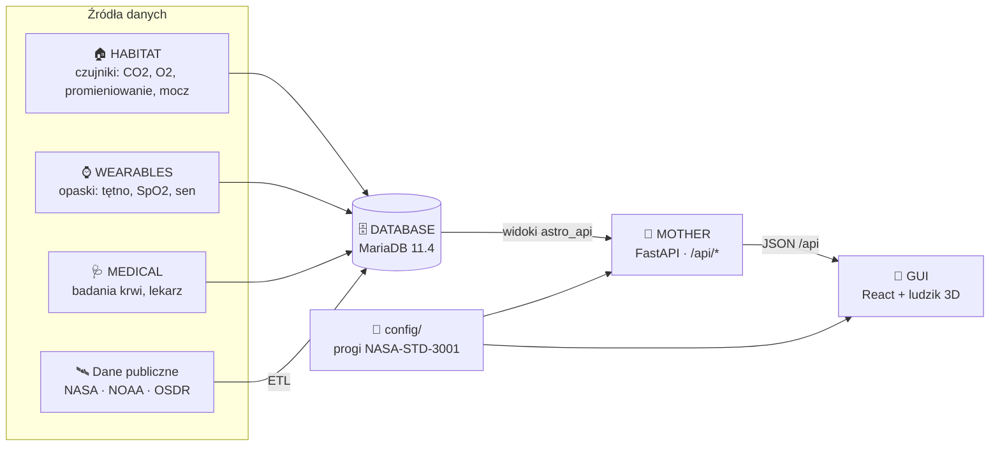

<div align="center">

# 🚀 AWERNASA

**Monitoring zdrowia załogi w habitacie na Marsie**

[](https://github.com/MrRooby/NASA-HACKATHON/actions/workflows/ci.yml)
[](https://github.com/MrRooby/NASA-HACKATHON/actions/workflows/release.yml)


*NASA Space Apps Challenge 2026: Create Health Monitoring Software for Astronauts on Space Missions*

</div>

---

4-osobowa załoga żyje w uszczelnionym **tunelu lawowym** na zboczu Elysium Mons. Czujniki habitatu, opaski na ciele (wearables) i badania medyczne zapisują dane do bazy. Backend **MOTHER** analizuje je według norm NASA, a **GUI** pokazuje stan zdrowia każdej osoby na **interaktywnym modelu 3D**: zielony to OK, żółty to uwaga, czerwony to alarm.

Pełny opis wyzwania: [CHALLENGE.md](CHALLENGE.md).

## 🧭 Jak to działa



## 📁 Struktura repozytorium

| Folder | Co to jest |
|---|---|
| `GUI/` | interfejs: React + Vite + three.js, model 3D kolorowany według stanu narządów |
| `MOTHER/` | backend: FastAPI, **tylko API JSON** (`/api/*`), czyta bazę i liczy analizę zdrowia |
| `DATABASE/` | MariaDB 11.4: schemat (`schema/`), import danych (`etl/`), generatory danych demo (`synthetic/`) |
| `HABITAT/` | plan danych z czujników habitatu, zdjęcia lokalizacji (`jaskinia/`) |
| `WEARABLES/`, `MEDICAL-DIAGNOSIS/` | opisy części systemu |
| `config/` | progi i źródła medyczne (NASA-STD-3001 itd.), wspólne dla całego zespołu |
| `data/` | dane publiczne (NASA, NOAA, OSDR…), zob. [DATA_SOURCES.md](DATA_SOURCES.md) i `data/public/README.md` |
| `deploy/` | uruchomienie całości w Dockerze i CI/CD, zob. [deploy/README.md](deploy/README.md) |

## ⚡ Szybki start: lokalnie (development)

### Wymagania
- **Tailscale** zalogowany do sieci zespołu: baza działa pod `100.118.238.112:3306`, dostępna tylko w tailnecie.
- **Python 3.10+** (backend).
- **Node 20+** (GUI). Na Node 16 Vite się nie uruchomi (`crypto.getRandomValues is not a function`). Z nvm: `nvm install 20`, potem w `GUI/` `nvm use`.
- **Login do bazy:** najlepiej użytkownik `astro_reader` (tylko odczyt); hasło od właściciela bazy.

### 1. Backend: MOTHER (terminal 1)
```bash
cd MOTHER
./start.sh          # Windows: start.bat
```
- Za pierwszym razem skrypt tworzy `MOTHER/.venv`, instaluje paczki i pyta o bazę. Przy wartościach w [nawiasach] wciśnij Enter, potem podaj użytkownika i hasło.
- Dane zapisują się w `MOTHER/.env` (w `.gitignore`, nie trafia do repo). Ponowne wpisanie: `./start.sh --setup`.
- API: **http://127.0.0.1:8000/api/status** (`"reachable": true` = baza OK), dokumentacja: **http://127.0.0.1:8000/api/docs**.
- Pierwsze `/api/dashboard` liczy się ok. 40 s. Karty narządów (`/api/organs/...`) działają od razu.

### 2. GUI (terminal 2)
```bash
cd GUI
nvm use                                         # Node 20 z .nvmrc
npm ci
MOTHER_URL=http://127.0.0.1:8000 npm run dev
```
- Otwórz adres z terminala (zwykle **http://localhost:5173**), kliknij logowanie demo.
- Na górnym pasku: **LIVE · MOTHER** = dane z bazy, **OFFLINE · demo data** = MOTHER nie odpowiada i GUI pokazuje wbudowane dane demo.
- Vite przekazuje `/api` do MOTHER (`GUI/vite.config.js`), więc nie ma problemów z CORS, a zmiany w GUI przeładowują się na żywo.
- Przykład z alarmem: osoba **HAB-C4**, sol **142**. Lewa noga świeci na czerwono (perfuzja 25%).

## 🐳 Całość w Dockerze (serwer)
```bash
cp deploy/.env.example deploy/.env      # uzupełnij hasła i BIND_IP (adres Tailscale serwera)
docker compose -f deploy/docker-compose.yml up -d --build
```
Wynik: GUI pod `http://<BIND_IP>:8081` (nginx przekazuje `/api/` do MOTHER), MOTHER pod `http://<BIND_IP>:8000/api/status` i MariaDB. Szczegóły, sekrety i rollback: [deploy/README.md](deploy/README.md).

## 🧪 Testy
```bash
python3 scripts/validate_config.py                          # spójność config/*.json
cd MOTHER   && pip install -r requirements-dev.txt && python -m pytest -q
cd DATABASE && pip install -r requirements-dev.txt && python -m pytest -q tests/unit
cd GUI      && npm test                                     # Node 20+
```
Testy działają bez bazy i bez sieci. Test integracyjny bazy (`DATABASE/tests/integration`) uruchamia się tylko, gdy ustawiona jest zmienna `ASTRO_TEST_DB_HOST`; w CI działa na tymczasowej MariaDB.

## 🔁 CI/CD (GitHub Actions)
- **`ci.yml`:** testy i build przy każdym pushu i pull requeście.
- **`release.yml`:** przy pushu na `master` lub `release/**` pakuje wszystko (GUI, MOTHER, DATABASE, deploy) do artefaktu `release-bundles` i publikuje obrazy w GHCR. Tag `vX.Y.Z` dodatkowo tworzy **GitHub Release**.
- **`deploy.yml`:** wdrożenie na serwer przez Tailscale i SSH (ręcznie albo po release; bez sekretów się pomija).

## 📜 Dane i zasady konkursu
- Wszystkie dane osób w bazie są **syntetyczne** albo pochodzą z publicznych zbiorów (Inspiration4/OSDR, LSDA). GUI oznacza dane syntetyczne etykietą **SYNTHETIC**.
- Zasady Space Apps (licencje, cytowania, użycie narzędzi SI, ograniczenia dotyczące Chin) opisuje [RULES-NASA.md](RULES-NASA.md).
- To demo edukacyjne, **nie porada medyczna**.

## ⚖️ Licencja
Copyright (C) 2026 the AWERNASA contributors.

Kod tego repozytorium (GUI, MOTHER, DATABASE, HABITAT, scripts, deploy) jest udostępniany na licencji **GNU Affero General Public License v3.0 only** (`SPDX-License-Identifier: AGPL-3.0-only`). Pełny tekst: [LICENSE](LICENSE).

- Każdy, kto rozpowszechnia ten kod albo jego przeróbki, musi udostępnić pełne źródła na tej samej licencji.
- Dotyczy to także uruchamiania zmienionej wersji jako usługi sieciowej (AGPL §13): użytkownicy usługi mają prawo do jej kodu źródłowego.
- Program jest dostarczany **bez żadnej gwarancji** (AGPL §15–16).

Materiały osób trzecich zachowują własne licencje i nie są objęte AGPL:
- zbiory danych w `data/public/` (np. MMASH na ODbL 1.0, zob. [data/public/human/raw/mmash/LICENSE.txt](data/public/human/raw/mmash/LICENSE.txt)); pełna lista źródeł i licencji: [DATA_SOURCES.md](DATA_SOURCES.md) i [RULES-NASA.md](RULES-NASA.md);
- zależności npm i Python (na licencjach MIT, BSD lub Apache-2.0) oraz fonty JetBrains Mono i Pixelify Sans (SIL OFL 1.1).
