<div align="center">

# AWERNASA

**Crew health terminal for a Mars lava-tube habitat**

<sub>NASA SPACE APPS CHALLENGE 2026 · <i>Create Health Monitoring Software for Astronauts on Space Missions</i></sub>

<br>

[](https://mrrooby.github.io/NASA-HACKATHON/)
&nbsp;
[](https://mrrooby.github.io/NASA-HACKATHON/cognitive.html)

</div>

> [!IMPORTANT]
> **The live demo is a preview of the interface, not the full application.**
> It is the frontend alone, hosted on GitHub Pages, with no MOTHER backend and no database behind it. Every screen runs on built-in sample data (badge `OFFLINE · DEMO`), so there are no live readings, and screens that need the backend, such as History, stay empty. To run the complete system, see [Quick start](#quick-start).

<div align="center">

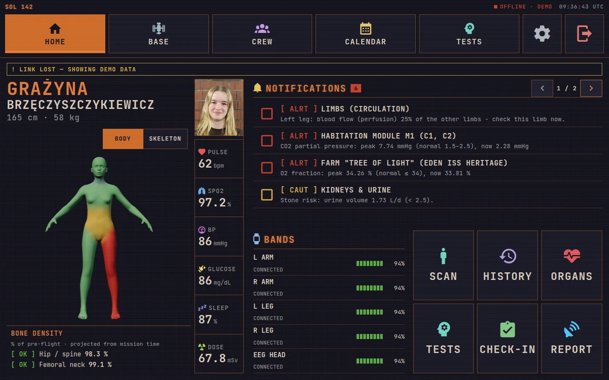

<br>

[](https://github.com/MrRooby/NASA-HACKATHON/actions/workflows/ci.yml)
[](https://github.com/MrRooby/NASA-HACKATHON/actions/workflows/release.yml)
[](https://github.com/MrRooby/NASA-HACKATHON/actions/workflows/pages.yml)


[About](#about) · [Features](#features) · [Screenshots](#screenshots) · [Architecture](#architecture) · [Quick start](#quick-start) · [Deployment](#deployment) · [Tests](#tests-and-cicd) · [Licence](#data-rules-and-licence)

</div>

## About

A crew of ten lives in a sealed lava tube on the slope of Elysium Mons. Habitat sensors, body-worn bands and medical tests all write to one database. The **MOTHER** backend checks every reading against NASA-STD-3001 limits, and the **GUI**, a touch-first tablet app styled as a habitat terminal, shows each person's state on a 3D model of their own body:

> 🟩 **OK** · 🟨 **CAUTION** · 🟥 **ALERT**

Away from Earth there is no flight surgeon on call, so the crew has to notice problems early on their own. AWERNASA puts the body, the habitat and the mind on one screen and says what to do next. The full challenge text is in [CHALLENGE.md](CHALLENGE.md).

## Features

| | |
|---|---|
| 🧍 **3D body status** | A model generated for each crew member's body, tinted per organ group. Switch between body and skeleton views; tap a body part to see its readings. |
| 🔔 **Actionable alerts** | Every alert names the measurement, its NASA limit and a concrete next step, e.g. *"Drink ≥ 2.5 L urine/day"* or *"check this limb now"*. |
| 🏠 **Habitat map** | The lava-tube base with live CO₂, O₂, radiation, temperature and water per room, the crew shown as dots in the rooms, and a sol slider to go back in time. |
| 👩‍🚀 **Crew overview** | All ten people with their status and the organ groups that need attention; open anyone for their profile, organs, bands and bone-density projection. |
| 📅 **Mission calendar** | Week and month views of tasks, with daily base status and crew wellbeing scores. |
| ✅ **Daily check-in** | Heart, body and mind questions with instant threshold feedback and escalation. |
| 🧠 **Cognitive tests** | PVT (reaction time), Go/No-Go (impulse control) and DSST (processing speed), each compared with the person's own baseline. Also runs as a standalone page with no login. |
| 📡 **Offline first** | Uses live data from MOTHER when it is reachable and built-in demo data when it is not, with a clear `OFFLINE · DEMO` badge. |
| 🎨 **Themes and languages** | Six colour themes (Nostromo, Phosphor CRT, Catppuccin…), JSON theme import, optional CRT scanlines, English and Polish. |

## Screenshots

### Login: choose a crew member
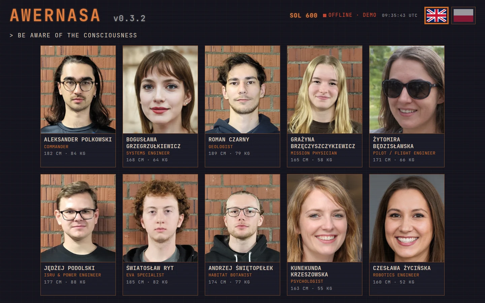

### Body and organs

<table>
  <tr>
    <td width="50%">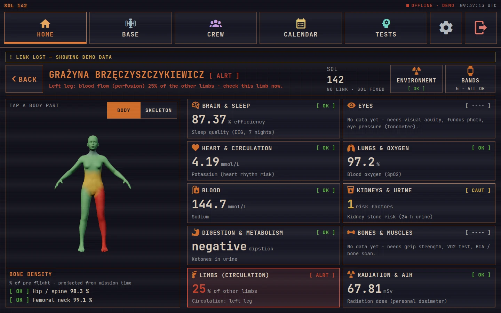<br><sub><b>Body scan</b>: every organ group with its latest value and status</sub></td>
    <td width="50%">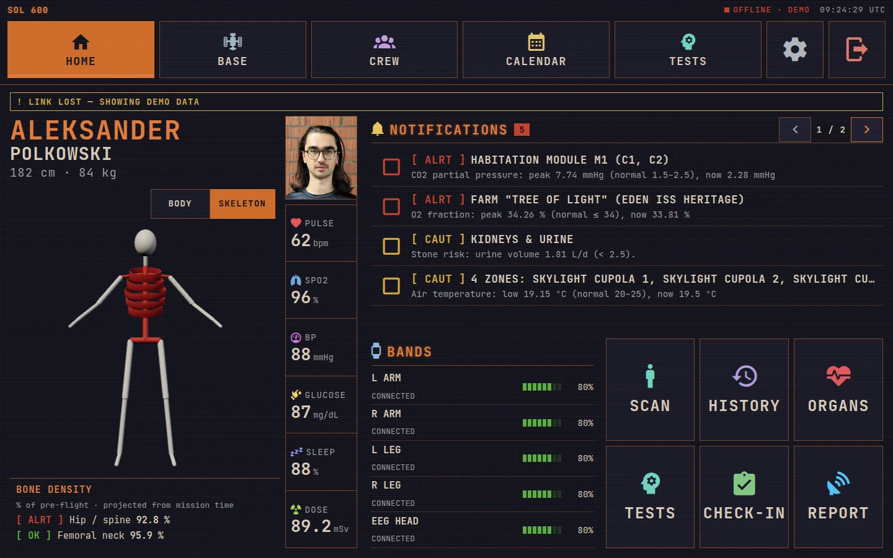<br><sub><b>Skeleton view</b>: bone-density projection from mission time</sub></td>
  </tr>
  <tr>
    <td>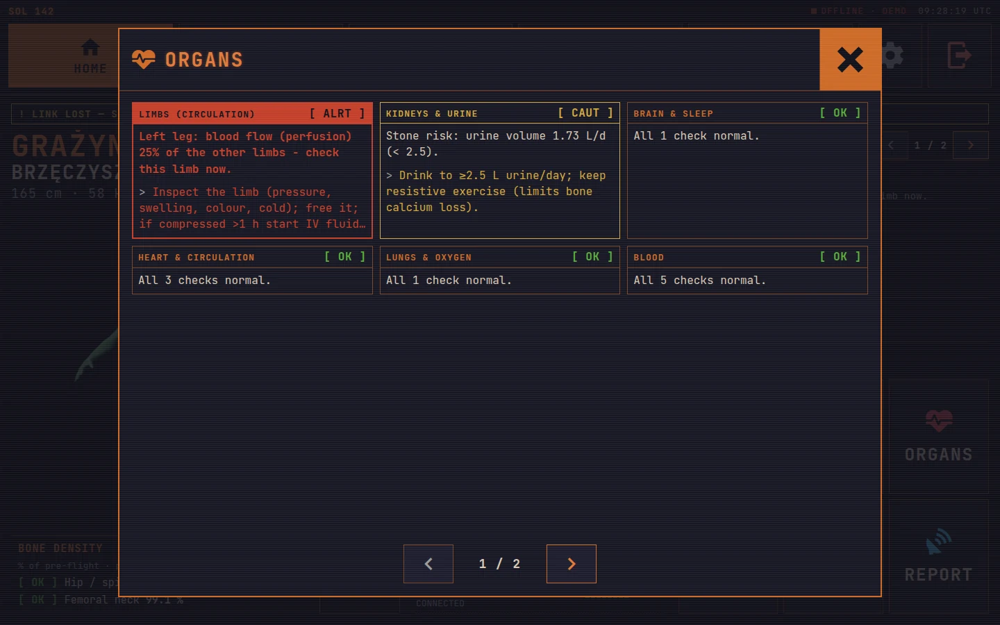<br><sub><b>Organs</b>: what is wrong and what to do about it</sub></td>
    <td>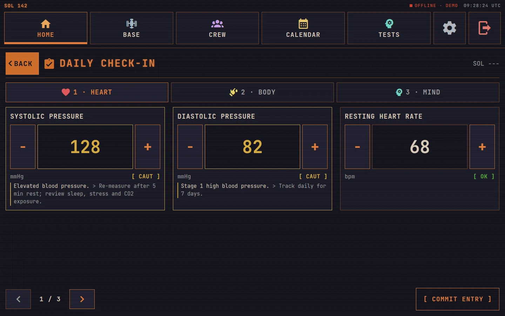<br><sub><b>Daily check-in</b>: instant feedback against the thresholds</sub></td>
  </tr>
</table>

### Crew and habitat

<table>
  <tr>
    <td width="50%">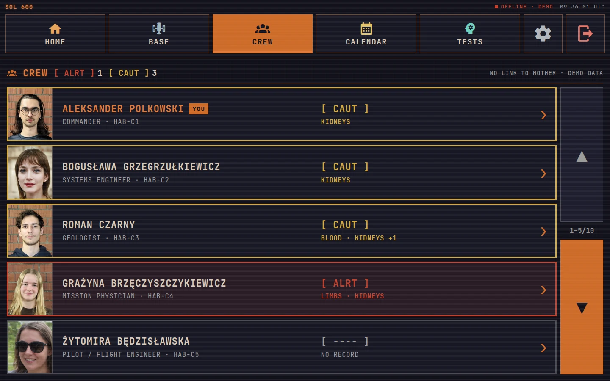<br><sub><b>Crew</b>: everyone's status at a glance</sub></td>
    <td width="50%">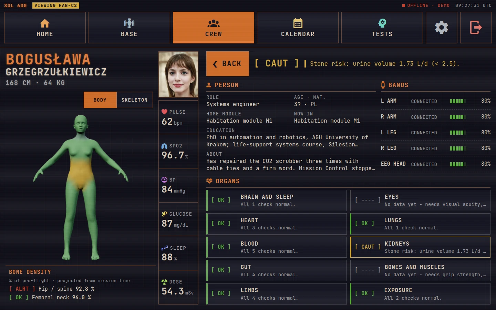<br><sub><b>Crew member</b>: profile, organs and bands</sub></td>
  </tr>
  <tr>
    <td colspan="2">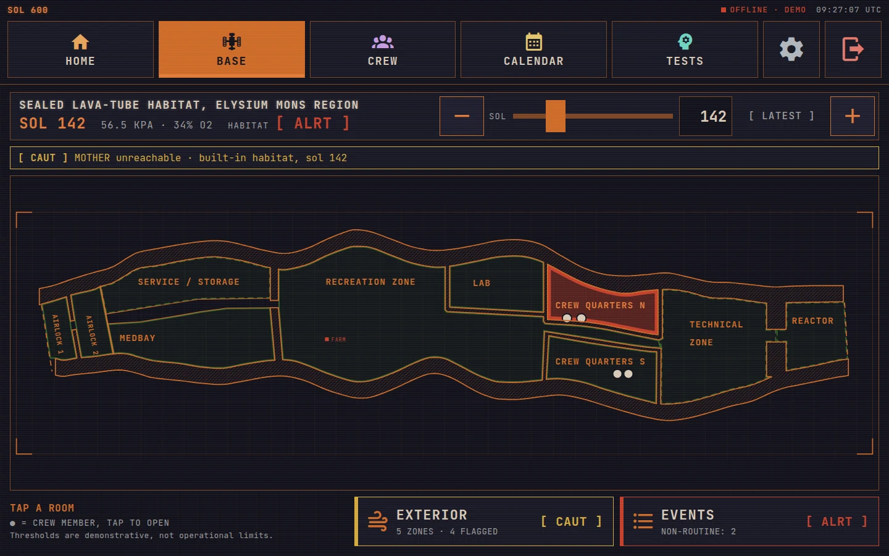<br><sub><b>Base map</b>: rooms, environment readings and crew positions for the selected sol</sub></td>
  </tr>
</table>

### Calendar

<table>
  <tr>
    <td width="50%">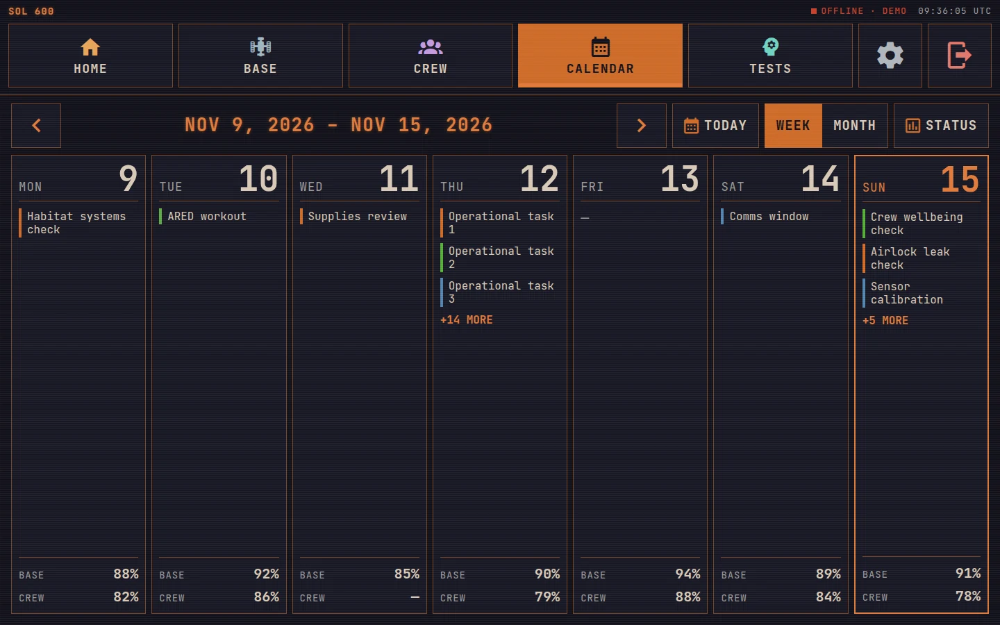<br><sub><b>Week</b>: tasks, base status and crew wellbeing per day</sub></td>
    <td width="50%">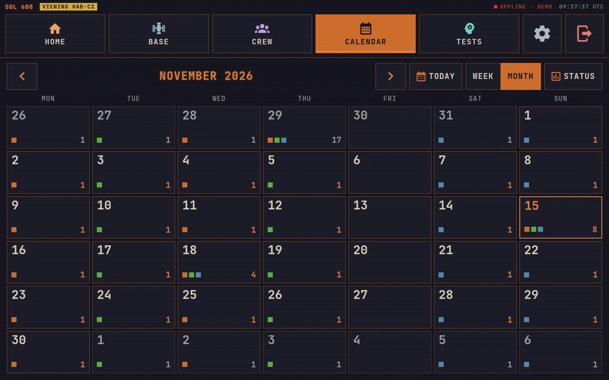<br><sub><b>Month</b>: status markers for every day</sub></td>
  </tr>
</table>

### Cognitive tests and settings

<table>
  <tr>
    <td width="50%">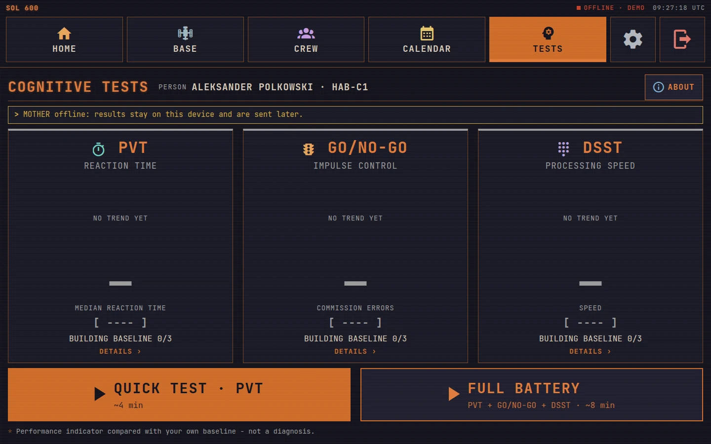<br><sub><b>Cognitive battery</b>: PVT, Go/No-Go and DSST against the person's own baseline</sub></td>
    <td width="50%">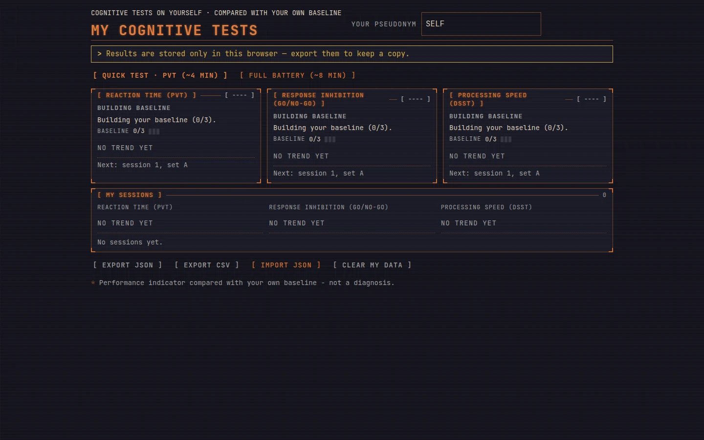<br><sub><b>Self-test</b> (<code>cognitive.html</code>): no login; results stay in your browser</sub></td>
  </tr>
  <tr>
    <td colspan="2">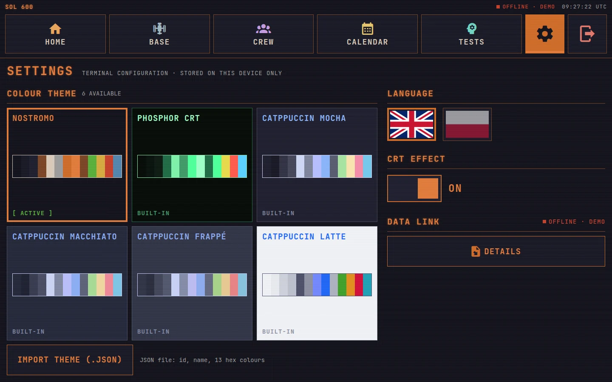<br><sub><b>Settings</b>: colour themes, language, CRT effect and data link</sub></td>
  </tr>
</table>

## Architecture

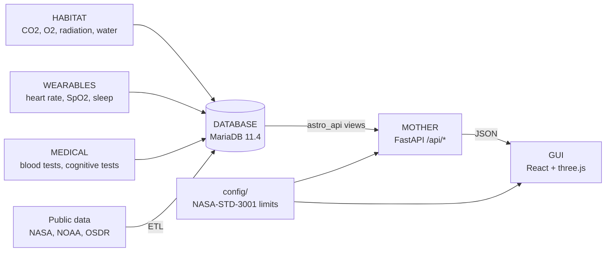

| Layer | Stack | Role |
|---|---|---|
| **GUI** | React 18, Vite 6, three.js / react-three-fiber, Vitest | Touch-first terminal UI; falls back to demo data when offline |
| **MOTHER** | Python, FastAPI | JSON API only (`/api/*`); reads the database and computes the health analysis |
| **DATABASE** | MariaDB 11.4, Python ETL | Schema, read-only API views, loaders for public datasets and synthetic data generators |
| **config** | JSON | Medical thresholds and their sources, shared by the backend and the GUI |

## Quick start

### Just the frontend (no backend needed)

```bash
cd GUI
nvm use            # Node 20+
npm ci
npm run dev        # http://localhost:5173 (shows OFFLINE · DEMO data)
```

No Node on the host? Use Docker:

```bash
docker run --rm -it -p 5173:5173 -v "$PWD":/repo -w /repo/GUI node:20 \
  sh -c "npm ci && npx vite --host 0.0.0.0"
```

### Full stack with live data

Requirements: Tailscale on the team network (the database is reachable only from the tailnet), Python 3.10+, Node 20+ and a database login (preferably the read-only `astro_reader`).

```bash
# terminal 1: backend
cd MOTHER
./start.sh                                   # Windows: start.bat

# terminal 2: GUI
cd GUI
MOTHER_URL=http://127.0.0.1:8000 npm run dev
```

The first run of `start.sh` creates `MOTHER/.venv`, installs dependencies and asks for the database login, which it saves to `MOTHER/.env` (ignored by git); `./start.sh --setup` asks again. Check http://127.0.0.1:8000/api/status (`"reachable": true` means the database is up). API docs are at `/api/docs`. The first `/api/dashboard` call takes about 40 s.

The top bar shows `LIVE · MOTHER` with real data and `OFFLINE` with demo data. Vite proxies `/api` to MOTHER, so no CORS setup is needed.

> Example alert: crew member HAB-C4 on sol 142, left leg red (perfusion 25 %).

## Deployment

### GitHub Pages (static demo)

[`.github/workflows/pages.yml`](.github/workflows/pages.yml) builds the GUI on every push to `master` that touches `GUI/` or `config/` and publishes it at **https://mrrooby.github.io/NASA-HACKATHON/**.

Pages hosts static files only, so the build sets two variables:

| Variable | Value | Effect |
|---|---|---|
| `VITE_BASE` | `/NASA-HACKATHON/` | the app and its 3D models load from the repository sub-path |
| `VITE_STATIC_DEMO` | `1` | the API client never calls `/api`, so every screen shows its built-in demo data |

To build the same bundle locally: `VITE_BASE=/NASA-HACKATHON/ VITE_STATIC_DEMO=1 npm run build` (output in `GUI/dist`).

### Docker (full stack on a server)

```bash
cp deploy/.env.example deploy/.env      # passwords and BIND_IP (the server's Tailscale address)
docker compose -f deploy/docker-compose.yml up -d --build
```

The GUI runs at `http://<BIND_IP>:8081` (nginx proxies `/api/` to MOTHER) and MOTHER at `http://<BIND_IP>:8000`. Secrets, releases and rollback are covered in [deploy/README.md](deploy/README.md).

## Tests and CI/CD

```bash
python3 scripts/validate_config.py
cd MOTHER   && pip install -r requirements-dev.txt && python -m pytest -q
cd DATABASE && pip install -r requirements-dev.txt && python -m pytest -q tests/unit
cd GUI      && npm test
```

The tests need neither the database nor the network. The database integration test (`DATABASE/tests/integration`) runs only when `ASTRO_TEST_DB_HOST` is set; CI runs it against a temporary MariaDB.

| Workflow | Trigger | What it does |
|---|---|---|
| [`ci.yml`](.github/workflows/ci.yml) | push, pull request | tests and build |
| [`release.yml`](.github/workflows/release.yml) | push to `master` / `release/**`, `vX.Y.Z` tag | release bundles, GHCR images, GitHub Release (on tags) |
| [`deploy.yml`](.github/workflows/deploy.yml) | manual, or after a tagged release | deploys to the team server over Tailscale and SSH |
| [`pages.yml`](.github/workflows/pages.yml) | push to `master` (GUI/config), manual | static demo on GitHub Pages |

## Repository layout

| Folder | Contents |
|---|---|
| [`GUI/`](GUI/README.md) | React + Vite + three.js app: home, habitat map, crew, calendar, cognitive tests |
| [`MOTHER/`](MOTHER/README.md) | FastAPI backend, JSON API only (`/api/*`) |
| [`DATABASE/`](DATABASE/README.md) | MariaDB schema (`schema/`), data import (`etl/`), demo data generators (`synthetic/`) |
| [`HABITAT/`](HABITAT/README.md) | habitat sensor data plan and site photos |
| `config/` | medical thresholds and their sources, shared by the backend and the GUI |
| `data/` | public datasets; see [DATA_SOURCES.md](DATA_SOURCES.md) |
| [`deploy/`](deploy/README.md) | Docker setup and CI/CD |
| `docs/screenshots/` | the images in this README |

## Data, rules and licence

- Crew data is either synthetic or taken from public datasets (Inspiration4/OSDR, LSDA). The crew members are fictional.
- The Space Apps rules (licences, citations, use of AI tools) are summarised in [RULES-NASA.md](RULES-NASA.md).
- **This is an educational demo, not medical advice.**

Copyright (C) 2026 the AWERNASA contributors.

The code is licensed under the **GNU Affero General Public License v3.0 only** (`SPDX-License-Identifier: AGPL-3.0-only`); see [LICENSE](LICENSE). It comes with no warranty. If you distribute it, or run a modified version as a network service, you must make the full source available under the same licence.

Third-party material keeps its own licence:
- datasets in `data/public/` (e.g. MMASH under ODbL 1.0); the full list is in [DATA_SOURCES.md](DATA_SOURCES.md);
- npm and Python dependencies (MIT, BSD, Apache-2.0);
- the Anny body model (Apache-2.0) with MakeHuman assets (CC0);
- fonts: JetBrains Mono and Nerd Fonts icons (SIL OFL 1.1 / MIT).
