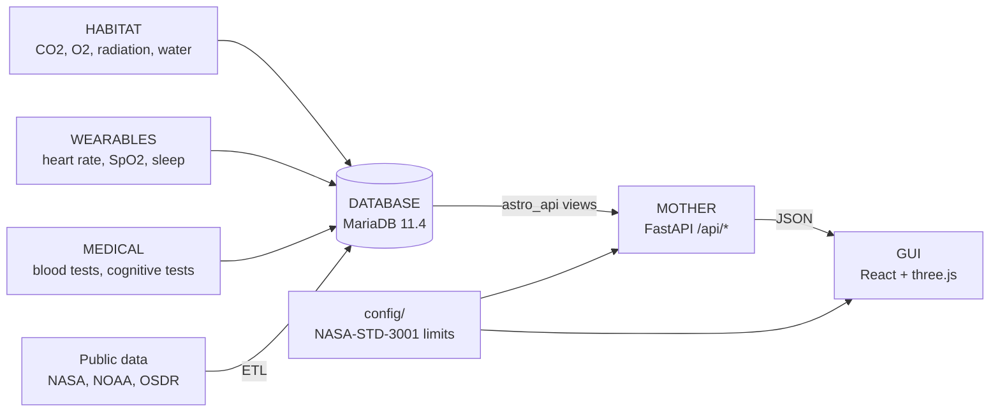

<div align="center">

# AWERNASA

**Crew health monitoring for a Mars lava-tube habitat**

[](https://github.com/MrRooby/NASA-HACKATHON/actions/workflows/ci.yml)
[](https://github.com/MrRooby/NASA-HACKATHON/actions/workflows/release.yml)


NASA Space Apps Challenge 2026: *Create Health Monitoring Software for Astronauts on Space Missions*

</div>

A crew lives in a sealed lava tube on the slope of Elysium Mons. Habitat sensors, body-worn bands and medical tests write to one database. The **MOTHER** backend checks the data against NASA limits, and the **GUI**, a touch-first tablet app, shows each person's state on a 3D body model: green is OK, yellow is caution, red is alert.

The full challenge text is in [CHALLENGE.md](CHALLENGE.md).

## Architecture



## Repository

| Folder | Contents |
|---|---|
| `GUI/` | React + Vite + three.js app: home view, habitat map, crew, calendar, cognitive tests |
| `MOTHER/` | FastAPI backend, JSON API only (`/api/*`); reads the database and computes the health analysis |
| `DATABASE/` | MariaDB schema (`schema/`), data import (`etl/`), demo data generators (`synthetic/`) |
| `HABITAT/` | habitat sensor data plan and site photos |
| `config/` | medical thresholds and their sources, shared by the backend and the GUI |
| `data/` | public datasets; see [DATA_SOURCES.md](DATA_SOURCES.md) |
| `deploy/` | Docker setup and CI/CD; see [deploy/README.md](deploy/README.md) |

## Running locally

Requirements:
- Tailscale on the team network (the database is at `100.118.238.112:3306`, reachable only from the tailnet);
- Python 3.10+;
- Node 20+ (Vite does not start on Node 16);
- a database login, preferably the read-only `astro_reader`.

**Backend** (terminal 1):
```bash
cd MOTHER
./start.sh          # Windows: start.bat
```
The first run creates `MOTHER/.venv`, installs dependencies and asks for the database login, which is saved to `MOTHER/.env` (ignored by git). Run `./start.sh --setup` to enter it again. Check http://127.0.0.1:8000/api/status (`"reachable": true` means the database is up); API docs are at http://127.0.0.1:8000/api/docs. The first `/api/dashboard` call takes about 40 s.

**GUI** (terminal 2):
```bash
cd GUI
nvm use
npm ci
MOTHER_URL=http://127.0.0.1:8000 npm run dev
```
Open the address Vite prints (usually http://localhost:5173) and pick a crew member. The top bar shows `LIVE · MOTHER` when data comes from the database and `OFFLINE` when MOTHER is unreachable; the GUI then uses built-in demo data. Vite proxies `/api` to MOTHER, so there is no CORS setup.

Example alert: crew member HAB-C4 on sol 142, left leg red (perfusion 25 %).

## Docker

```bash
cp deploy/.env.example deploy/.env      # passwords and BIND_IP (the server's Tailscale address)
docker compose -f deploy/docker-compose.yml up -d --build
```
The GUI runs at `http://<BIND_IP>:8081` (nginx proxies `/api/` to MOTHER), MOTHER at `http://<BIND_IP>:8000`. Secrets and rollback: [deploy/README.md](deploy/README.md).

## Tests

```bash
python3 scripts/validate_config.py
cd MOTHER   && pip install -r requirements-dev.txt && python -m pytest -q
cd DATABASE && pip install -r requirements-dev.txt && python -m pytest -q tests/unit
cd GUI      && npm test
```
The tests need neither the database nor the network. The database integration test (`DATABASE/tests/integration`) runs only when `ASTRO_TEST_DB_HOST` is set; CI runs it against a temporary MariaDB.

## CI/CD

- `ci.yml`: tests and build on every push and pull request.
- `release.yml`: on push to `master` or `release/**`, packages GUI, MOTHER, DATABASE and deploy as the `release-bundles` artifact and publishes images to GHCR. A `vX.Y.Z` tag also creates a GitHub Release.
- `deploy.yml`: deploys to the server over Tailscale and SSH, manually or after a release; skipped when secrets are missing.

## Data and rules

- Crew data in the database is either synthetic or taken from public datasets (Inspiration4/OSDR, LSDA). The crew members are fictional.
- Space Apps rules (licences, citations, use of AI tools) are summarised in [RULES-NASA.md](RULES-NASA.md).
- This is an educational demo, not medical advice.

## License

Copyright (C) 2026 the AWERNASA contributors.

The code in this repository is licensed under the GNU Affero General Public License v3.0 only (`SPDX-License-Identifier: AGPL-3.0-only`); see [LICENSE](LICENSE). It comes with no warranty. If you distribute it, or run a modified version as a network service, you must make the full source available under the same licence.

Third-party material keeps its own licence:
- datasets in `data/public/` (e.g. MMASH under ODbL 1.0); the full list is in [DATA_SOURCES.md](DATA_SOURCES.md);
- npm and Python dependencies (MIT, BSD, Apache-2.0);
- the Anny body model (Apache-2.0) with MakeHuman assets (CC0);
- fonts: JetBrains Mono and Nerd Fonts icons (SIL OFL 1.1 / MIT).
